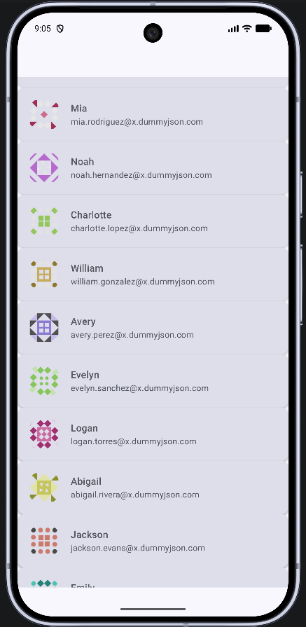
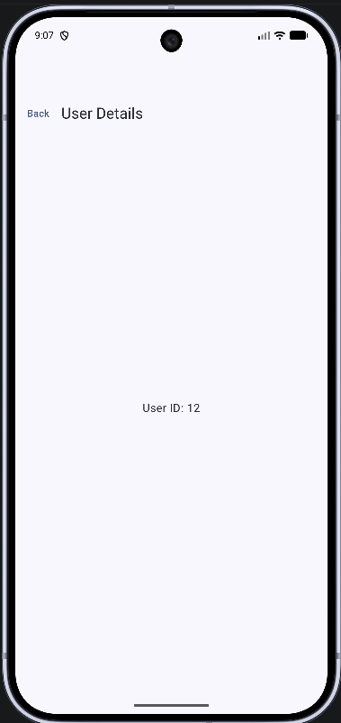

# UserListApp

An Android user list app built with **Jetpack Compose**, featuring manual pagination, MVVM architecture, Navigation Compose, and Coil image loading.

## Screenshots

### User List


### User Detail


## Features

- Paginated user list with infinite scroll (no Paging 3 library)
- MVVM with StateFlow and SharedFlow
- Navigation Compose for list → detail flow
- Retrofit + DummyJSON API
- Coil 3 for profile images
- Unit tests with JUnit and Mockito

## Tech Stack

| Layer | Technology |
|-------|------------|
| UI | Jetpack Compose, Material 3 |
| Architecture | MVVM |
| Networking | Retrofit, OkHttp |
| Images | Coil 3 |
| Navigation | Navigation Compose |
| Tests | JUnit, Mockito |

## Getting Started

1. Clone the repository
2. Open in Android Studio
3. Run on an emulator or device

```bash
git clone https://github.com/Vikas00413/UserListApp.git
```

## Run Tests

```bash
./gradlew :app:testDebugUnitTest
```

## API

Uses [DummyJSON](https://dummyjson.com) users endpoint.

## License

See [LICENSE](LICENSE).
